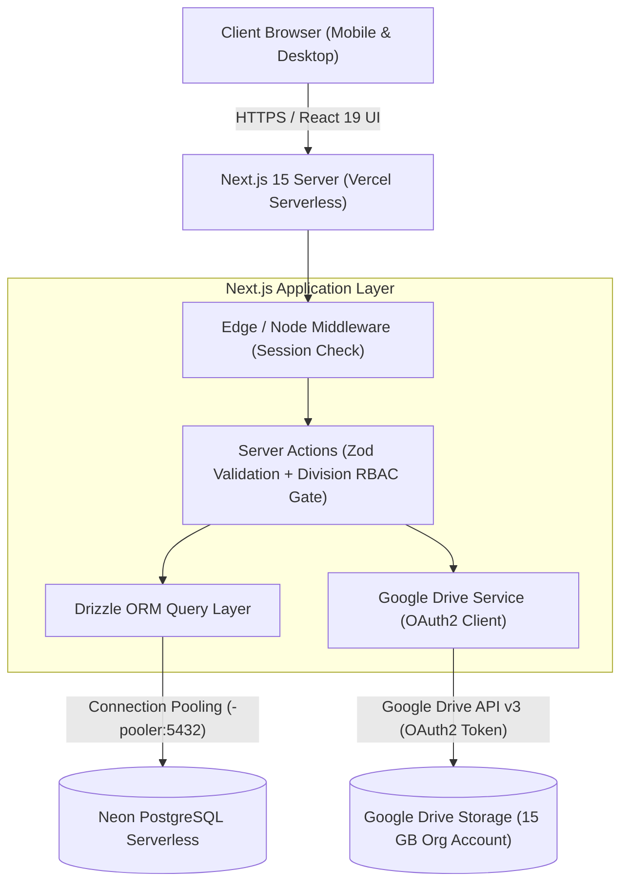

# Dokumen Arsitektur & Desain Sistem (System Architecture Document)

**Proyek:** Pandawa App (Sistem Informasi Manajemen Organisasi Kepemudaan)  
**Versi:** 1.1.0 (Revisi Struktur Divisi & Fitur Baru)  
**Status:** Draf Final  

---

## 1. Arsitektur Tingkat Tinggi (*High-Level Architecture*)



---

## 2. Struktur Peran & Matriks Izin (Berdasarkan Divisi)

Role didefinisikan berdasarkan divisi dan jabatan struktural:
* `ketua_umum`
* `wakil_ketua`
* `sekretaris`
* `bendahara`
* `divisi_acara`
* `divisi_humas`
* `divisi_logistik`
* `divisi_keamanan`
* `anggota`

Contoh resolusi izin pada *Server Actions*:
```typescript
// lib/auth/permissions.ts
export const PERMISSIONS = {
  // Wakil Ketua (Keorganisasian Internal)
  'members:manage': ['ketua_umum', 'wakil_ketua'],
  'organization:structure': ['ketua_umum', 'wakil_ketua'],

  // Sekretariat (Persuratan Resmi)
  'letters:manage': ['sekretaris'],
  'letters:request': ['ketua_umum', 'wakil_ketua', 'bendahara', 'divisi_acara', 'divisi_humas', 'divisi_logistik', 'divisi_keamanan'],
  'letters:approve': ['ketua_umum', 'sekretaris'],

  // Keuangan (Kas & Iuran)
  'cash:manage': ['bendahara'],
  'cash:approve_large': ['ketua_umum'],
  'dues:manage_routine': ['bendahara'],

  // Acara & Iuran Khusus
  'events:manage': ['divisi_acara'],
  'event_dues:manage': ['divisi_acara', 'bendahara'],

  // Humas (Kalender & Sounding)
  'calendar:manage': ['divisi_humas'],
  'broadcast:generate': ['divisi_humas'],

  // Logistik (Inventaris Harga Ganda)
  'inventory:manage': ['divisi_logistik'],
  'inventory:rent_external': ['divisi_logistik'],

  // Keamanan & Insiden
  'incidents:confidential_view': ['ketua_umum', 'wakil_ketua', 'divisi_keamanan'],
  'incidents:public_view': ['*'],
  'incidents:create': ['*'],
} as const;
```

---

## 3. Desain Skema Database Drizzle ORM Lengkap

### 3.1 Skema Autentikasi & Keanggotaan (Internal - Wakil Ketua)
```typescript
// schema/auth.ts
export const users = pgTable('users', {
  id: text('id').primaryKey(),
  name: varchar('name', { length: 100 }).notNull(),
  email: varchar('email', { length: 100 }).unique().notNull(),
  phone: varchar('20').notNull(),
  passwordHash: text('password_hash').notNull(),
  avatarDriveId: text('avatar_drive_id'),
  avatarDriveUrl: text('avatar_drive_url'),
  isActive: boolean('is_active').default(true),
  createdAt: timestamp('created_at').defaultNow().notNull(),
  updatedAt: timestamp('updated_at').defaultNow().notNull(),
});

export const roles = pgTable('roles', {
  id: serial('id').primaryKey(),
  key: varchar('key', { length: 50 }).unique().notNull(), // ketua_umum, wakil_ketua, sekretaris, bendahara, divisi_acara, divisi_humas, divisi_logistik, divisi_keamanan, anggota
  name: varchar('name', { length: 100 }).notNull(),
  division: varchar('division', { length: 50 }),
  description: text('description'),
});

export const periods = pgTable('periods', {
  id: serial('id').primaryKey(),
  name: varchar('name', { length: 50 }).notNull(), // "Periode 2026–2028"
  startYear: integer('start_year').notNull(),
  endYear: integer('end_year').notNull(),
  isActive: boolean('is_active').default(false),
  createdAt: timestamp('created_at').defaultNow().notNull(),
});

export const userRoles = pgTable('user_roles', {
  id: serial('id').primaryKey(),
  userId: text('user_id').references(() => users.id, { onDelete: 'cascade' }).notNull(),
  roleId: integer('role_id').references(() => roles.id, { onDelete: 'cascade' }).notNull(),
  periodId: integer('period_id').references(() => periods.id, { onDelete: 'cascade' }).notNull(),
  assignedAt: timestamp('assigned_at').defaultNow().notNull(),
});

export const members = pgTable('members', {
  id: serial('id').primaryKey(),
  userId: text('user_id').references(() => users.id, { onDelete: 'cascade' }).notNull(),
  periodId: integer('period_id').references(() => periods.id, { onDelete: 'cascade' }).notNull(),
  memberNumber: varchar('member_number', { length: 50 }).unique(),
  positionTitle: varchar('position_title', { length: 100 }).notNull(), // "Wakil Ketua", "Koordinator Sie Humas"
  division: varchar('division', { length: 50 }).notNull(), // "BPH", "Humas", "Acara", "Logistik", "Keamanan"
  status: varchar('status', { length: 20 }).default('active').notNull(), // active, inactive, alumni
  joinedAt: timestamp('joined_at').defaultNow().notNull(),
});
```

### 3.2 Skema Persuratan Resmi (Sekretaris)
```typescript
// schema/letters.ts
export const letterTypeEnum = pgEnum('letter_type', [
  'UNDANGAN',
  'PERINGATAN',
  'GIRIK_IURAN',
  'SURAT_TUGAS',
  'PERMOHONAN',
  'REKOMENDASI',
  'SURAT_KEPUTUSAN',
  'SURAT_MASUK',
]);

export const letters = pgTable('letters', {
  id: serial('id').primaryKey(),
  periodId: integer('period_id').references(() => periods.id).notNull(),
  direction: varchar('direction', { length: 10 }).notNull(), // IN, OUT
  letterType: letterTypeEnum('letter_type').notNull(),
  letterNumber: varchar('letter_number', { length: 100 }).unique().notNull(), // e.g. "014/UND/KT/XI/2026"
  sequenceNumber: integer('sequence_number').notNull(),
  year: integer('year').notNull(),
  subject: varchar('subject', { length: 255 }).notNull(),
  sender: varchar('sender', { length: 150 }).notNull(),
  recipient: varchar('recipient', { length: 150 }).notNull(),
  letterDate: date('letter_date').notNull(),
  fileDriveId: text('file_drive_id'),
  fileDriveUrl: text('file_drive_url'),
  status: varchar('status', { length: 25 }).default('APPROVED').notNull(), // DRAFT, PENDING_APPROVAL, APPROVED, REJECTED, ARCHIVED
  // TTD Resmi (Tanpa barcode, verifikasi metadata ttd digital)
  primarySignatoryName: varchar('primary_signatory_name', { length: 100 }), // Ketua Umum
  secondarySignatoryName: varchar('secondary_signatory_name', { length: 100 }), // Sekretaris
  signedAt: timestamp('signed_at'),
  isPublic: boolean('is_public').default(false),
  requestedByDivision: varchar('requested_by_division', { length: 50 }), // divisi yang mengajukan draf
  createdBy: text('created_by').references(() => users.id).notNull(),
  createdAt: timestamp('created_at').defaultNow().notNull(),
});

export const letterDispositions = pgTable('letter_dispositions', {
  id: serial('id').primaryKey(),
  letterId: integer('letter_id').references(() => letters.id, { onDelete: 'cascade' }).notNull(),
  assignedToUserId: text('assigned_to_user_id').references(() => users.id).notNull(),
  instructions: text('instructions').notNull(),
  status: varchar('status', { length: 20 }).default('PENDING').notNull(),
  createdAt: timestamp('created_at').defaultNow().notNull(),
});
```

### 3.3 Skema Keuangan & Iuran Acara (Bendahara & Divisi Acara)
```typescript
// schema/finance.ts
export const wallets = pgTable('wallets', {
  id: serial('id').primaryKey(),
  name: varchar('name', { length: 100 }).notNull(), // "Kas Utama", "Kas Sosial", "Kas Usaha", "Kas Acara"
  description: text('description'),
  currentBalance: bigint('current_balance', { mode: 'number' }).default(0).notNull(),
  isActive: boolean('is_active').default(true),
  createdAt: timestamp('created_at').defaultNow().notNull(),
});

export const cashTransactions = pgTable('cash_transactions', {
  id: text('id').primaryKey(), // UUID
  walletId: integer('wallet_id').references(() => wallets.id).notNull(),
  type: varchar('type', { length: 10 }).notNull(), // IN, OUT
  category: varchar('category', { length: 50 }).notNull(),
  amount: bigint('amount', { mode: 'number' }).notNull(),
  transactionDate: date('transaction_date').notNull(),
  description: text('description').notNull(),
  receiptDriveId: text('receipt_drive_id'),
  receiptDriveUrl: text('receipt_drive_url'),
  status: varchar('status', { length: 20 }).default('APPROVED').notNull(), // APPROVED, PENDING_APPROVAL, REJECTED
  requiresApproval: boolean('requires_approval').default(false), // true jika > 500.000
  approvedBy: text('approved_by').references(() => users.id),
  approvedAt: timestamp('approved_at'),
  rejectionReason: text('rejection_reason'),
  eventId: integer('event_id'),
  createdBy: text('created_by').references(() => users.id).notNull(),
  createdAt: timestamp('created_at').defaultNow().notNull(),
});

// Iuran Rutin Bulanan
export const routineDuesSchedules = pgTable('routine_dues_schedules', {
  id: serial('id').primaryKey(),
  periodId: integer('period_id').references(() => periods.id).notNull(),
  title: varchar('title', { length: 100 }).notNull(),
  amountPerPeriod: bigint('amount_per_period', { mode: 'number' }).notNull(),
  frequency: varchar('frequency', { length: 20 }).default('monthly'), // monthly, weekly
  isActive: boolean('is_active').default(true),
});

export const routineDuesPayments = pgTable('routine_dues_payments', {
  id: serial('id').primaryKey(),
  scheduleId: integer('schedule_id').references(() => routineDuesSchedules.id).notNull(),
  memberId: integer('member_id').references(() => members.id).notNull(),
  walletId: integer('wallet_id').references(() => wallets.id).notNull(),
  periodLabel: varchar('period_label', { length: 30 }).notNull(), // "2026-11"
  amount: bigint('amount', { mode: 'number' }).notNull(),
  paymentDate: date('payment_date').notNull(),
  proofDriveId: text('proof_drive_id'),
  recordedBy: text('recorded_by').references(() => users.id).notNull(),
  createdAt: timestamp('created_at').defaultNow().notNull(),
});

// Iuran Khusus Acara (Event Dues Ledger)
export const eventDuesSchedules = pgTable('event_dues_schedules', {
  id: serial('id').primaryKey(),
  eventId: integer('event_id').notNull(), // relasi ke events
  targetAmountPerMember: bigint('target_amount_per_member', { mode: 'number' }).notNull(),
  dueDate: date('due_date').notNull(),
  notes: text('notes'),
  isActive: boolean('is_active').default(true),
  createdAt: timestamp('created_at').defaultNow().notNull(),
});

export const eventDuesPayments = pgTable('event_dues_payments', {
  id: serial('id').primaryKey(),
  eventDuesScheduleId: integer('event_dues_schedule_id').references(() => eventDuesSchedules.id).notNull(),
  memberId: integer('member_id').references(() => members.id).notNull(),
  walletId: integer('wallet_id').references(() => wallets.id).notNull(),
  amountPaid: bigint('amount_paid', { mode: 'number' }).notNull(),
  status: varchar('status', { length: 20 }).default('LUNAS'), // LUNAS, SEBAGIAN
  paymentDate: date('payment_date').notNull(),
  proofDriveId: text('proof_drive_id'),
  notes: text('notes'),
  recordedBy: text('recorded_by').references(() => users.id).notNull(),
  createdAt: timestamp('created_at').defaultNow().notNull(),
});
```

### 3.4 Skema Kegiatan, Kalender Humas, & Broadcast
```typescript
// schema/events.ts
export const events = pgTable('events', {
  id: serial('id').primaryKey(),
  periodId: integer('period_id').references(() => periods.id).notNull(),
  title: varchar('title', { length: 200 }).notNull(),
  description: text('description'),
  location: varchar('location', { length: 200 }).notNull(),
  startTime: timestamp('start_time').notNull(),
  endTime: timestamp('end_time').notNull(),
  status: varchar('status', { length: 20 }).default('PLANNING').notNull(), // PLANNING, ONGOING, COMPLETED, CANCELED
  
  // Alokasi Pendanaan
  plannedBudget: bigint('planned_budget', { mode: 'number' }).default(0),
  kasAllocation: bigint('kas_allocation', { mode: 'number' }).default(0),
  externalSponsorAmount: bigint('external_sponsor_amount', { mode: 'number' }).default(0),
  hasSpecialDues: boolean('has_special_dues').default(false),
  
  // Dokumen Pendukung & Google Drive
  associatedLetterId: integer('associated_letter_id').references(() => letters.id),
  driveFolderId: text('drive_folder_id'),
  driveFolderUrl: text('drive_folder_url'),
  
  picUserId: text('pic_user_id').references(() => users.id).notNull(),
  lpjNotes: text('lpj_notes'),
  createdBy: text('created_by').references(() => users.id).notNull(),
  createdAt: timestamp('created_at').defaultNow().notNull(),
});

export const eventCommittees = pgTable('event_committees', {
  id: serial('id').primaryKey(),
  eventId: integer('event_id').references(() => events.id, { onDelete: 'cascade' }).notNull(),
  userId: text('user_id').references(() => users.id, { onDelete: 'cascade' }).notNull(),
  section: varchar('section', { length: 50 }).notNull(),
  roleTitle: varchar('role_title', { length: 50 }).notNull(),
});
```

### 3.5 Skema Inventaris Harga Ganda (Divisi Logistik)
```typescript
// schema/inventory.ts
export const assets = pgTable('assets', {
  id: serial('id').primaryKey(),
  code: varchar('code', { length: 50 }).unique().notNull(), // AST-TND-001
  name: varchar('name', { length: 150 }).notNull(),
  category: varchar('category', { length: 50 }).notNull(),
  totalQuantity: integer('total_quantity').notNull(),
  availableQuantity: integer('available_quantity').notNull(),
  condition: varchar('condition', { length: 25 }).default('GOOD').notNull(), // GOOD, MINOR_DAMAGE, MAJOR_DAMAGE, LOST
  storageLocation: varchar('storage_location', { length: 100 }).notNull(),
  photoDriveId: text('photo_drive_id'),
  isRentable: boolean('is_rentable').default(false),
  
  // Skema Harga Ganda
  internalRatePerDay: bigint('internal_rate_per_day', { mode: 'number' }).default(0), // Harga Anggota/Warga
  externalRatePerDay: bigint('external_rate_per_day', { mode: 'number' }).default(0), // Harga Pihak Luar
  
  createdAt: timestamp('created_at').defaultNow().notNull(),
});

export const assetLoans = pgTable('asset_loans', {
  id: serial('id').primaryKey(),
  assetId: integer('asset_id').references(() => assets.id).notNull(),
  clientTier: varchar('client_tier', { length: 15 }).notNull(), // INTERNAL (Harga Dalam), EXTERNAL (Harga Luar)
  borrowerName: varchar('borrower_name', { length: 100 }).notNull(),
  borrowerPhone: varchar('borrower_phone', { length: 25 }).notNull(),
  quantity: integer('quantity').notNull(),
  startDate: date('start_date').notNull(),
  expectedEndDate: date('expected_end_date').notNull(),
  actualEndDate: date('actual_end_date'),
  purpose: text('purpose').notNull(),
  totalFee: bigint('total_fee', { mode: 'number' }).default(0),
  cashTransactionId: text('cash_transaction_id').references(() => cashTransactions.id),
  status: varchar('status', { length: 20 }).default('REQUESTED').notNull(), // REQUESTED, BORROWED, RETURNED, REJECTED, OVERDUE
  returnCondition: varchar('return_condition', { length: 25 }),
  returnNotes: text('return_notes'),
  processedBy: text('processed_by').references(() => users.id).notNull(),
  createdAt: timestamp('created_at').defaultNow().notNull(),
});
```

### 3.6 Skema Insiden & Pelaporan Aspirasi (Divisi Keamanan)
```typescript
// schema/incidents.ts
export const incidents = pgTable('incidents', {
  id: serial('id').primaryKey(),
  title: varchar('title', { length: 200 }).notNull(),
  category: varchar('category', { length: 50 }).notNull(),
  description: text('description').notNull(),
  location: varchar('location', { length: 150 }).notNull(),
  incidentTime: timestamp('incident_time').notNull(),
  urgency: varchar('urgency', { length: 20 }).notNull(), // LOW, MEDIUM, HIGH, EMERGENCY
  
  // Visibilitas Laporan
  isConfidential: boolean('is_confidential').default(false).notNull(), // true = hanya pelapor, keamanan, ketua/wakil
  
  status: varchar('status', { length: 20 }).default('OPEN').notNull(), // OPEN, IN_PROGRESS, RESOLVED, CLOSED
  reporterUserId: text('reporter_user_id').references(() => users.id),
  reporterName: varchar('reporter_name', { length: 100 }).notNull(),
  proofDriveId: text('proof_drive_id'),
  proofDriveUrl: text('proof_drive_url'),
  createdAt: timestamp('created_at').defaultNow().notNull(),
  updatedAt: timestamp('updated_at').defaultNow().notNull(),
});

export const incidentAssignees = pgTable('incident_assignees', {
  id: serial('id').primaryKey(),
  incidentId: integer('incident_id').references(() => incidents.id, { onDelete: 'cascade' }).notNull(),
  assignedUserId: text('assigned_user_id').references(() => users.id).notNull(),
  assignedAt: timestamp('assigned_at').defaultNow().notNull(),
});

export const incidentLogs = pgTable('incident_logs', {
  id: serial('id').primaryKey(),
  incidentId: integer('incident_id').references(() => incidents.id, { onDelete: 'cascade' }).notNull(),
  authorUserId: text('author_user_id').references(() => users.id).notNull(),
  actionTaken: text('action_taken').notNull(),
  proofDriveId: text('proof_drive_id'),
  proofDriveUrl: text('proof_drive_url'),
  createdAt: timestamp('created_at').defaultNow().notNull(),
});
```

---

## 4. Fitur Khusus: Kalender Terpadu & Sounding WhatsApp Humas

### 4.1 Sinkronisasi Kalender Dashboard Anggota
* Query kalender mengambil seluruh agenda `events` pada rentang bulan aktif.
* Di sisi UI:
  * **Dashboard Humas:** Tampilan kalender besar (FullCalendar / BigCalendar) dengan interaksi klik tanggal untuk *Create Event*, modal detail, tombol tautkan surat, dan tombol *Generate Sounding*.
  * **Dashboard Anggota:** Kalender responsif yang menampilkan tanda agenda, jadwal kegiatan kepemudaan, serta detail acara saat diklik.

### 4.2 Generator Pesan Sounding Humas
Utility murni di sisi Next.js yang merangkum parameter acara menjadi format Markdown / WhatsApp text template untuk disalin ke clipboard dengan satu klik.
