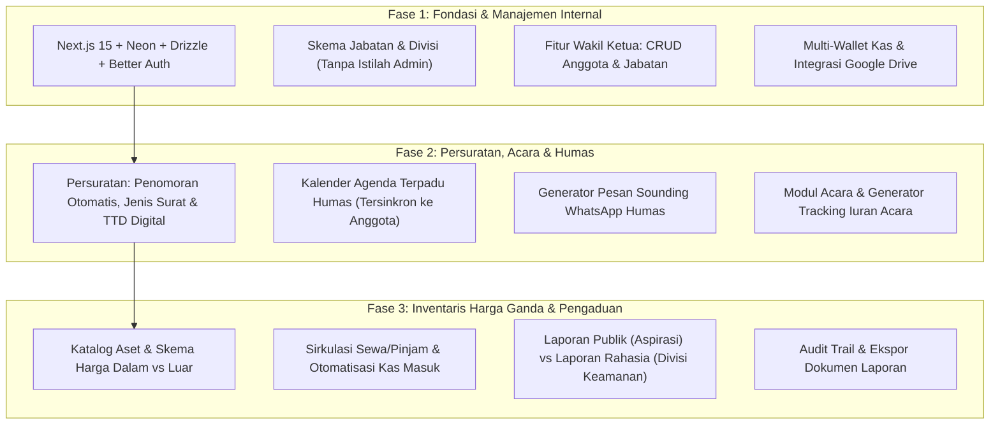

# Product Requirements Document (PRD)
## Sistem Informasi Manajemen Administrasi & Operasional Organisasi Kepemudaan (Pandawa App)

* **Status:** Revised (v1.1.0)  
* **Versi:** 1.1.0  
* **Model Deployment:** Single-Tenant (Satu Organisasi Utama), Multi-User, Dynamic Multi-Role RBAC  
* **Tech Stack:** Next.js 15+ (App Router, Server Actions, TypeScript), Neon PostgreSQL Serverless, Drizzle ORM, Better Auth, Google Drive API, Tailwind CSS + shadcn/ui  
* **Target Lingkungan:** Vercel (Hobby Tier) + Neon Serverless (Free Tier)  

---

## 1. Ringkasan Eksekutif & Tujuan Produk
Pandawa App adalah platform web manajemen terpadu untuk digitalisasi tata kelola kepengurusan organisasi kepemudaan (seperti Karang Taruna, himpunan pemuda tingkat RW/Desa/Kelurahan). Seluruh hierarki hak akses menggunakan istilah **Divisi / Jabatan Pengurus** (bukan "Admin"), dengan pemisahan tugas yang tegas antara pengelolaan internal organisasi (Wakil Ketua) dan tata kelola persuratan resmi (Divisi Kesekretariatan).

---

## 2. Struktur Peran & Dynamic RBAC (Berdasarkan Jabatan/Divisi)

Aplikasi menerapkan konsep **Dynamic Multi-Role**, di mana 1 pengurus dapat memegang beberapa peran secara dinamis sesuai surat keputusan (SK) periode aktif.

### 2.1 Definisi Jabatan & Divisi Kepengurusan
1. **Ketua Umum:**
   * Pimpinan tertinggi organisasi; memiliki visibilitas menyeluruh (*Supervisory & Audit*).
   * Otoritas persetujuan (*approval*) pengeluaran kas bernominal besar (`> Rp500.000`).
   * Menyetujui penerbitan surat keluar resmi bersama Sekretaris.
   * Mengakses laporan kejadian berstatus rahasia (*confidential*).
2. **Wakil Ketua (Bidang Internal & Keanggotaan):**
   * Fokus pada tata kelola organisasi ke dalam: mengelola struktur kepengurusan, divisi, dan jabatan.
   * Hak akses penuh (CRUD) data anggota, status keaktifan, dan direktori keanggotaan.
   * Menjadi koordinator harian lintas divisi dan *approver* cadangan jika Ketua Umum berhalangan.
3. **Divisi Kesekretariatan (Sekretaris Umum & Wakil):**
   * Pengelola tunggal tata kelola persuratan resmi organisasi.
   * Mengelola **Surat Masuk** (pencatatan, pengarsipan berkas scan, dan penerusan lembar disposisi).
   * Menerbitkan dan memverifikasi **Surat Keluar** dengan nomor surat otomatis (Surat Undangan, Surat Peringatan [SP 1, 2, 3], Girik Penagihan Iuran Anggota, Surat Tugas, Surat Permohonan, Surat Rekomendasi).
   * Format pengesahan surat menggunakan **Tanda Tangan (TTD) Digital Resmi & Stempel Organisasi** (tanpa barcode).
   * Menyimpan master arsip dokumen PDF surat ke Google Drive `/02_PERSURATAN/`.
4. **Divisi Keuangan (Bendahara 1 & 2):**
   * Mengelola pos dompet kas (*multi-wallet*): Kas Utama, Kas Sosial, Kas Usaha, Kas Acara.
   * Mengelola pencatatan pemasukan & pengeluaran kas (wajib lampiran nota bukti transaksi).
   * Mengelola penagihan dan rekonsiliasi **Iuran Rutin Anggota** serta menerima setoran **Iuran Khusus Acara** dari Divisi Acara.
5. **Divisi Acara (Sie Acara / Kreatif):**
   * Merencanakan kegiatan, menyusun timeline acara, dan Rencana Anggaran Biaya (RAB).
   * **Mekanisme Iuran Acara Khusus:** Jika acara membutuhkan pendanaan mandiri dari anggota, Divisi Acara dapat mengaktifkan skema iuran khusus per acara dan men-generate form tracking pembayaran ke seluruh anggota.
   * Berkoordinasi dengan Divisi Keuangan untuk pelaporan realisasi dana acara dan menyusun LPJ.
6. **Divisi Humas (Hubungan Masyarakat & Komunikasi):**
   * **Penyusun & Pengelola Kalender Agenda Terpadu (Big Calendar View):** Menyusun agenda organisasi yang secara otomatis tersinkronisasi dan tampil di kalender dashboard setiap anggota. Humas dapat mengklik tanggal di kalender besar untuk membuat kegiatan, melampirkan detail, dan menautkan surat pendukung.
   * **Generator Pesan Sounding Grup:** Membantu memformat pesan siaran (*broadcast sounding*) ke grup WhatsApp anggota/warga berdasarkan data surat dan acara resmi:
     * Detail kegiatan (nama, tujuan, jadwal, lokasi).
     * Rincian sumber dana (alokasi dari kas vs sumber eksternal) dan total kebutuhan biaya.
     * Permintaan iuran (jika acara menggunakan skema iuran) beserta batas waktu dan kanal/tempat setor iuran.
7. **Divisi Logistik & Inventaris (Sie Perlengkapan):**
   * Mengelola katalog aset fisik barang (tenda, sound system, kursi, terpal, proyektor, peralatan olahraga, dsb.).
   * Mengelola sirkulasi peminjaman dengan **Dua Skema Tarif (Harga Ganda):**
     * **Harga Dalam:** Tarif subsidi / khusus untuk anggota organisasi atau warga lingkungan internal.
     * **Harga Luar:** Tarif komersial standar untuk pihak/instansi di luar lingkungan organisasi.
   * Integrasi pelunasan sewa komersial secara otomatis ke pencatatan kas masuk Divisi Keuangan.
   * Berita acara pengembalian aset, pencatatan kondisi fisik, dan evaluasi denda/kerusakan.
8. **Divisi Keamanan & Konseling:**
   * Menangani laporan insiden, gangguan ketertiban acara, konflik internal, atau pelaporan darurat.
   * Menindaklanjuti tiket pengaduan, menunjuk PIC penanganan lapangan, mencatat notula mediasi, dan menutup kasus.
   * Mengelola investigasi terhadap laporan berstatus rahasia (*confidential*).
9. **Anggota (Member):**
   * Mengakses kalender agenda kegiatan di dashboard pribadi.
   * Memantau tagihan dan riwayat pembayaran iuran rutin maupun iuran acara khusus.
   * Mengajukan peminjaman aset inventaris (otomatis mendapatkan tarif Harga Dalam).
   * Membuat laporan aspirasi atau insiden dengan opsi visibilitas: **Publik** (tampil di dashboard forum anggota) atau **Rahasia** (hanya dibaca oleh pelapor, Divisi Keamanan, dan Ketua Umum).

---

### 2.2 Matriks Hak Akses Granular (*Permission Matrix*)

| Modul / Fitur | Ketua Umum | Wakil Ketua | Sekretaris | Bendahara | Divisi Acara | Divisi Humas | Divisi Logistik | Divisi Keamanan | Anggota |
| :--- | :---: | :---: | :---: | :---: | :---: | :---: | :---: | :---: | :---: |
| **Periode & Struktur Org** | CRUD | CRUD | R | R | R | R | R | R | R |
| **Data Anggota & Jabatan** | CRUD | CRUD | R | R | R | R | R | R | R (Profil) |
| **Buku Kas & Multi-Wallet**| R / Approve | R | R | CRUD | R | R | R | R | R (Summary) |
| **Iuran Rutin Anggota** | R | R | R (Girik) | CRUD | R | R | R | R | R (Tagihan) |
| **Iuran Khusus Acara** | R | R | R | Rekonsiliasi | CRUD Form | R (Sounding) | - | - | R (Tagihan) |
| **Persuratan (Masuk & Keluar)**| R / Approve | R | CRUD | R | Request Draft| Request Draft | Request Draft | Request Draft | R (Publik) |
| **Kalender Agenda Terpadu**| R | R | R | R | Input Acara | CRUD Kalender| R | R | R (Sinkron) |
| **Pesan Sounding Grup** | R | R | R | R | R | Generator CRUD| - | - | R |
| **Inventaris (Katalog Aset)**| R | R | R | - | R | R | CRUD | R | R |
| **Sirkulasi Pinjam/Sewa** | R | R | R | R (Sewa) | R (Pinjam) | R (Pinjam) | CRUD | R | Pinjam (Harga Dalam) |
| **Kegiatan, RAB & LPJ** | R / Approve | R | R | R (Audit Kas)| CRUD | R (Agenda) | R (Logistik) | R (Pengamanan)| R (Agenda) |
| **Laporan Publik (Aspirasi)**| CRUD / Assign | CRUD | CRUD | R | R | R | R | CRUD / Assign | Create / R (Semua) |
| **Laporan Rahasia (Insiden)**| CRUD / Assign | CRUD | - | - | - | - | - | CRUD / Assign | Create / R (Milik Sendiri) |
| **Audit Logs Sistem** | Read Only | Read Only | - | - | - | - | - | - | - |

*(Keterangan: C = Create, R = Read, U = Update, D = Delete, Assign = Penugasan PIC, Request Draft = Mengajukan Draf Surat)*

---

## 3. Spesifikasi Kebutuhan Fungsional Baru & Ditingkatkan

### 3.1 Tata Kelola Internal Anggota (Wakil Ketua)
* **Manajemen Anggota & Jabatan:**
  * Wakil Ketua memiliki kewenangan penuh mendaftarkan anggota baru, memperbarui jabatan struktural (Ketua, Sekretaris, Koordinator Divisi, Anggota Divisi), dan memperbarui status (`Aktif`, `Non-Aktif`, `Alumni`).
  * Penyaringan anggota berdasarkan divisi untuk memudahkan pembagian tim kerja.

### 3.2 Modul Persuratan & Konsep Draf Divisi (Divisi Kesekretariatan)
* **Pola Pengajuan & Penerbitan Surat:**
  * Seluruh divisi dapat mengajukan **Permohonan / Draf Surat** (misal: Divisi Acara meminta Surat Undangan Pembicara, Divisi Logistik meminta Surat Peminjaman Tempat, Bendahara meminta Girik Tagihan Iuran).
  * Sekretaris meninjau draf, menetapkan kode klasifikasi surat, dan sistem menerbitkan nomor surat otomatis berurutan.
* **Jenis Surat Resmi:**
  1. *Surat Undangan (UND)*: Untuk rapat internal, pertemuan warga, tokoh masyarakat.
  2. *Surat Peringatan (SP)*: SP 1, SP 2, SP 3 bagi anggota yang melanggar AD/ART atau tidak aktif.
  3. *Girik / Surat Penagihan Iuran (GI)*: Diterbitkan resmi untuk penagihan iuran anggota/warga.
  4. *Surat Tugas (ST)*: Penugasan delegasi pengurus ke acara luar atau kepanitiaan.
  5. *Surat Permohonan / Kerjasama (SPM)*: Permohonan dana, tempat, logistik, atau sponsor.
  6. *Surat Keputusan (SK)*: Pengesahan panitia atau struktur kepengurusan.
* **Pengesahan Surat:**
  * Menggunakan **Tanda Tangan Digital & Stempel** resmi kepengurusan (Ketua Umum & Sekretaris) tanpa barcode, disimpan dalam format PDF final di Google Drive.

### 3.3 Modul Acara & Iuran Khusus Acara (Divisi Acara & Bendahara)
* **Skema Pendanaan Acara:**
  * Setiap kegiatan dapat memiliki pos pendanaan: Dana Kas Organisasi, Sponsor/Donatur, dan **Iuran Acara**.
* **Formulir Tracking Iuran Acara:**
  * Jika acara memungut iuran (misal: Makrab Rp50.000/orang atau Wisata Pemuda), Divisi Acara mengaktifkan modul iuran pada acara tersebut.
  * Sistem membuat lembar tagihan ke seluruh anggota aktif.
  * Panitia acara / Bendahara dapat mencatat status pembayaran (`Lunas`, `Belum Bayar`, `Sebagian`) lengkap dengan tanggal dan bukti setor.

### 3.4 Modul Humas: Kalender Agenda Terpadu & Sounding Broadcast
* **Kalender Agenda Terpadu (Big Interactive Calendar):**
  * Tampilan kalender bulanan dan mingguan interaktif berukuran penuh di dashboard Humas dan dashboard seluruh anggota.
  * Humas dapat mengklik tanggal pada kalender untuk menambahkan agenda baru, menentukan penanggung jawab, serta menyematkan dokumen surat resmi terkait.
  * Setiap pembaruan kalender langsung tersinkronisasi ke tampilan kalender anggota secara real-time.
* **Generator Pesan Sounding WhatsApp:**
  * Tombol "Buat Pesan Sounding" pada detail acara/surat yang otomatis menyusun format pesan WhatsApp siap salin:
    ```text
    *PEMBERITAHUAN KEGIATAN KEPEMUDAAN*
    Acara: [Nama Acara]
    Hari/Tanggal: [Hari, Tanggal & Waktu]
    Tempat: [Lokasi Kegiatan]
    
    *Rincian Sumber Dana:*
    - Alokasi Kas Organisasi: Rp[Nominal]
    - Sumber Eksternal/Sponsor: Rp[Nominal]
    - Total Kebutuhan Anggaran: Rp[Total]
    
    *Iuran Anggota:*
    - Besaran Iuran: Rp[Nominal per Orang]
    - Batas Pembayaran: [Tanggal Jatuh Tempo]
    - Kanal Penyetoran: [Transfer Rekening Bendahara / Tunai ke Sie Acara]
    
    Surat Resmi No: [Nomor Surat dari Sekretaris]
    Mari bersama sukseskan kegiatan kita!
    ```

### 3.5 Modul Inventaris dengan Skema Harga Ganda (Divisi Logistik)
* **Katalog Aset Lengkap:**
  * Mendukung inventaris dalam jumlah banyak dan beragam kategori (Tenda, Sound, Panggung, Kursi, Meja, Terpal, Alat Masak, Alat Musik).
* **Skema Tarif Ganda (Dual Pricing):**
  * Setiap barang yang dapat disewakan memiliki dua kolom harga per hari:
    * `internal_rate_per_day` (Harga Dalam): Diskon subsidi / gratis untuk anggota organisasi atau warga setempat.
    * `external_rate_per_day` (Harga Luar): Tarif sewa komersial untuk instansi/pihak luar.
* **Integrasi Kas Otomatis:**
  * Pembayaran sewa komersial otomatis menerbitkan draf mutasi kas masuk ke Bendahara.

### 3.6 Pengaduan & Laporan: Publik vs Rahasia
* **Laporan Publik (Aspirasi / Fasilitas Umum):**
  * Ditampilkan di dashboard seluruh anggota aktif untuk mendukung keterbukaan dan musyawarah.
* **Laporan Rahasia (Insiden / Pelanggaran / Isu Pribadi):**
  * Diberi tanda `is_confidential = true`.
  * **HANYA** dapat dilihat oleh:
    1. Anggota pelapor.
    2. Divisi Keamanan & Konseling.
    3. Ketua Umum dan Wakil Ketua.
  * Anggota lain tidak dapat melihat judul maupun eksistensi tiket tersebut di dashboard mereka.

---

## 4. Rencana Tahapan Rilis (Updated Roadmap)


