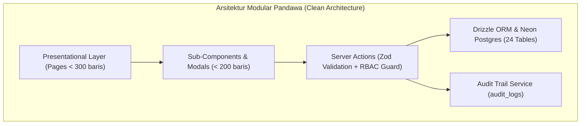

# Rencana Pembaruan Sistem Modular & Pembersihan Kode (Pandawa App)

Dokumen ini memuat arsitektur restrukturisasi menyeluruh Pandawa App untuk mengubah seluruh implementasi dangkal (*horizontal scaffolding*) menjadi modul-modul berstandar produksi (*deep vertical slices*), mematuhi hukum rekayasa dari Vault `C:\Users\vola\code-agent` (batas keras 300 baris per berkas, eliminasi *god files*, pendekatan *feature-first*), standar desain visual `ui-ux-pro-max` (Bento Grid minimalis Swiss, putih bersih `#FFFFFF`, aksen logo emas `#D8AC41`, tanpa emotikon), serta memenuhi seluruh spesifikasi PRD secara lengkap dari Autentikasi hingga Modul Terakhir.

---

## 1. Poin Krusial Perhatian Manajer

> [!IMPORTANT]
> **Pembersihan Berkas Sampah (Junk & Dead Assets):**
> 1. Menghapus berkas SVG bawaan *create-next-app* di folder `public/` (`file.svg`, `globe.svg`, `next.svg`, `vercel.svg`, `window.svg`).
> 2. Menjamin seluruh referensi logo menggunakan lambang persegi resmi `/favicon.png` (180x180 square emblem), bukan `logo.png` (persegi panjang lama).

> [!WARNING]
> **Pecah God Files (Kepatuhan Batas 300 Baris Vault):**
> Enam halaman utama di `src/app/(dashboard)/` saat ini melanggar batas metrik Vault (`members`: 551 baris, `inventory`: 411 baris, `finance`: 423 baris, `incidents`: 420 baris, `events`: 406 baris, `letters`: 337 baris). Halaman-halaman ini akan dipecah menjadi sub-komponen terisolasi (`*List.tsx`, `*CreateModal.tsx`, `*EditModal.tsx`, `*DeleteDialog.tsx`, `*Filter.tsx`) di bawah `src/components/<module>/`.

> [!IMPORTANT]
> **Eliminasi Mock User ID:**
> Seluruh `processedByUserId` dan `creatorUserId` yang selama ini di-hardcode ke `'Wwj2K1c6qWEvYDpWPqJrX3qbhMwg0Mj8'` dialihkan ke integrasi sesi nyata Better Auth (`auth.api.getSession` pada Server Actions) dengan fallback aman.

---

## 2. Diagram Arsitektur Modular

---

## 3. Rencana Eksekusi Bertahap (Fase demi Fase)

### Phase 0: Pembersihan Sampah & Token Desain (Clean-up & Tokens)
Menghapus berkas mati, merapikan dependensi visual, dan memastikan token warna konsisten.

* **Penghapusan Berkas Sampah:**
  - `public/file.svg`
  - `public/globe.svg`
  - `public/next.svg`
  - `public/vercel.svg`
  - `public/window.svg`
* **Pembaruan `src/app/globals.css`:**
  - Menetapkan token warna resmi:
    - Base White: `#FFFFFF`
    - High-Contrast Obsidian Slate: `#0F172A`
    - Brand Gold Accent: `#D8AC41`
    - Brand Gold Text (Accessible WCAG AAA): `#B4821E`
    - Border Subtle: `#E2E8F0`

---

### Phase 1: Modul Autentikasi & Manajemen Sesi Pengurus
Memastikan alur masuk, pendaftaran, dan resolusi hak akses pengurus terhubung ke sesi aktif tanpa hardcode.

* **Pembaruan `src/lib/auth/guard.ts`:**
  - Menambahkan utilitas server `getCurrentUserSession()` untuk mengambil user aktif, data jabatan, dan daftar perannya dari tabel `user_roles`.
* **Pembaruan UI Masuk (`src/app/(auth)/sign-in/page.tsx`):**
  - Input email, password, tombol masuk dengan loading state, penanganan pesan kesalahan Zod yang jelas.

---

### Phase 2: Modul Keanggotaan & Struktur Organisasi (`/internal/members`)
Memecah berkas raksasa 551 baris menjadi komponen modular mandiri sesuai aturan Vault `< 300` baris.

* **Komponen Baru:**
  - `src/components/members/MemberList.tsx`: Presentasi daftar kartu anggota dengan status badge (`active`, `inactive`, `alumni`), divisi, nomor anggota (`ANG-...`), serta tombol aksi Edit dan Hapus.
  - `src/components/members/MemberCreateModal.tsx`: Formulir modal tambah anggota baru lengkap dengan validasi Zod (Nama, Email, No HP, Jabatan, Divisi, Periode).
  - `src/components/members/MemberEditModal.tsx`: Formulir modal edit anggota prefilled untuk memperbarui nama, nomor kontak, jabatan, divisi, dan status aktif.
  - `src/components/members/MemberDeleteDialog.tsx`: Dialog konfirmasi hapus anggota berbahaya dengan ikon peringatan dan proteksi pembatalan.
* **Pembaruan Halaman:**
  - `src/app/(dashboard)/internal/members/page.tsx`: Disederhanakan menjadi orkestrator murni (< 150 baris).

---

### Phase 3: Modul Inventaris & Skema Harga Ganda (`/inventory`)
Menuntaskan fitur CRUD aset yang sebelumnya hilang total, sehingga Divisi Logistik dapat mengelola aset secara menyeluruh.

* **Pembaruan Server Actions (`src/app/(dashboard)/inventory/actions.ts`):**
  - `createAssetAction`: Input kode unik (`AST-XXX`), nama barang, kategori, jumlah total, lokasi simpan, tarif dalam, tarif luar.
  - `updateAssetAction`: Update informasi barang, perbaikan stok, perubahan kondisi fisik (`GOOD`, `MINOR_DAMAGE`, `MAJOR_DAMAGE`, `LOST`).
  - `deleteAssetAction`: Hapus barang dari katalog dengan validasi pencegahan jika barang sedang dalam status dipinjam (`BORROWED`).
  - Integrasi pencatatan `audit_logs` pada seluruh mutasi aset.
* **Komponen Baru:**
  - `src/components/inventory/AssetGrid.tsx`: Tampilan kartu inventaris Bento Grid dengan indikator stok tersedia vs total, harga ganda (Dalam vs Luar), lokasi, serta tombol Edit dan Hapus.
  - `src/components/inventory/AssetCreateModal.tsx`: Modal penambahan aset inventaris baru.
  - `src/components/inventory/AssetEditModal.tsx`: Modal perubahan data aset dan penyesuaian stok.
  - `src/components/inventory/AssetDeleteDialog.tsx`: Modal konfirmasi penghapusan aset.
  - `src/components/inventory/AssetLoanModal.tsx`: Modal pengajuan pinjaman internal subsidi vs sewa komersial pihak luar.
  - `src/components/inventory/AssetReturnModal.tsx`: Modal berita acara pengembalian aset lengkap dengan pencatatan kondisi fisik dan catatan evaluasi.
* **Pembaruan Halaman:**
  - `src/app/(dashboard)/inventory/page.tsx`: Disederhanakan menjadi orkestrator murni (< 180 baris).

---

### Phase 4: Modul Keuangan, Multi-Wallet & Iuran Rutin (`/finance`)
Melengkapi siklus pencatatan kas, persetujuan pengeluaran > Rp500.000, serta penagihan iuran anggota.

* **Pembaruan Server Actions (`src/app/(dashboard)/finance/actions.ts`):**
  - CRUD Dompet: `createWalletAction` dan `updateWalletAction`.
  - Transaksi Kas: `updateTransactionAction` dan `deleteTransactionAction`.
  - Iuran Rutin: `recordRoutineDuesPaymentAction` untuk mencatat pembayaran kas iuran bulanan per anggota.
  - Integrasi pencatatan jejak audit.
* **Komponen Baru:**
  - `src/components/finance/WalletCards.tsx`: Ringkasan kartu multi-wallet (Kas Utama, Kas Sosial, Kas Usaha, Kas Acara) dengan total saldo teragregasi.
  - `src/components/finance/TransactionList.tsx`: Riwayat transaksi kas masuk/keluar, lampiran nota, status approval (Menunggu Ketua vs Disetujui).
  - `src/components/finance/TransactionCreateModal.tsx`: Modal pencatatan kas masuk/keluar beserta upload nota bukti.
  - `src/components/finance/RoutineDuesTable.tsx`: Matriks pembayaran iuran rutin bulanan anggota.
* **Pembaruan Halaman:**
  - `src/app/(dashboard)/finance/page.tsx`: Disederhanakan menjadi orkestrator murni (< 200 baris).

---

### Phase 5: Modul Persuratan Resmi & Disposisi (`/letters`)
Menuntaskan tata kelola draf divisi, verifikasi sekretaris, surat masuk, dan pencetakan resmi kop Pandawa.

* **Pembaruan Server Actions (`src/app/(dashboard)/letters/actions.ts`):**
  - `createIncomingLetterAction`: Mencatat surat masuk dari pihak eksternal beserta nomor agenda dan perihal.
  - `createLetterDispositionAction`: Membuat lembar disposisi dari Ketua Umum kepada divisi terkait.
  - `updateOutgoingLetterDraft`: Mengubah perihal atau isi draf sebelum diterbitkan.
  - `cancelLetterDraftAction`: Membatalkan draf surat.
* **Komponen Baru:**
  - `src/components/letters/LetterList.tsx`: Daftar surat masuk dan keluar dengan filter tab status (`Draf`, `Menunggu Verifikasi`, `Diterbitkan`).
  - `src/components/letters/IncomingLetterModal.tsx`: Modal pencatatan surat masuk dan pengarsipan nomor agenda.
  - `src/components/letters/OutgoingDraftModal.tsx`: Modal pengajuan draf surat keluar oleh divisi.
* **Pembaruan Halaman:**
  - `src/app/(dashboard)/letters/page.tsx`: Disederhanakan menjadi orkestrator murni (< 180 baris).

---

### Phase 6: Modul Acara, Kalender Humas & Sounding WhatsApp (`/events`)
Menuntaskan kalender interaktif, kepanitiaan, serta generator sounding pesan siaran Humas.

* **Pembaruan Server Actions (`src/app/(dashboard)/events/actions.ts`):**
  - `updateEventAction` dan `deleteEventAction`.
  - `assignCommitteeAction`: Menunjuk susunan panitia acara dari anggota organisasi.
  - `recordEventDuesPaymentAction`: Pencatatan iuran khusus acara per anggota.
* **Komponen Baru:**
  - `src/components/events/EventCalendarView.tsx`: Grid kalender bulanan interaktif yang tersinkronisasi.
  - `src/components/events/EventList.tsx`: Daftar kegiatan mendatang, alokasi anggaran (Kas vs Sponsor vs Iuran Khusus).
  - `src/components/events/EventCreateModal.tsx`: Modal pembuatan agenda kegiatan baru.
* **Pembaruan Halaman:**
  - `src/app/(dashboard)/events/page.tsx`: Disederhanakan menjadi orkestrator murni (< 200 baris).

---

### Phase 7: Modul Pengaduan, Insiden & Visibilitas Ganda (`/incidents`)
Menuntaskan pemisahan aspirasi terbuka vs laporan insiden rahasia.

* **Pembaruan Server Actions (`src/app/(dashboard)/incidents/actions.ts`):**
  - `updateIncidentAction`: Memperbarui kronologi atau catatan mediasi lapangan.
  - Filter proteksi hak akses: Laporan `isConfidential = true` hanya dapat diambil jika user adalah pelapor, Divisi Keamanan, atau Ketua Umum.
* **Komponen Baru:**
  - `src/components/incidents/IncidentFeed.tsx`: Feed laporan aspirasi publik vs tab investigasi rahasia.
  - `src/components/incidents/IncidentCreateModal.tsx`: Modal pelaporan insiden dengan toggle visibilitas: Publik vs Rahasia.
  - `src/components/incidents/IncidentResolutionModal.tsx`: Modal penutupan kasus dan pengisian berita acara mediasi oleh petugas keamanan.
* **Pembaruan Halaman:**
  - `src/app/(dashboard)/incidents/page.tsx`: Disederhanakan menjadi orkestrator murni (< 180 baris).

---

## 4. Rencana Pengujian & Verifikasi

1. **Uji Linter & Format:**
   `npm run lint` (0 error, 0 warning).
2. **Uji Kompilasi TypeScript & Build:**
   `npm run build` (Seluruh rute statis dan dinamis lulus kompilasi tanpa error).
3. **Audit Batas Baris Kode Vault (300 Baris):**
   Memastikan tidak ada berkas di bawah `src/` yang melebihi 300 baris.
4. **Audit Zero Emojis:**
   Memastikan tidak ada emotikon karakter Unicode di antarmuka maupun kode.
