# Dokumen Riset Teknis (Technical Research)

**Proyek:** Sistem Informasi Manajemen Administrasi & Operasional Organisasi Kepemudaan (Pandawa App)  
**Tanggal:** 22 November 2026  
**Status:** Selesai / Terverifikasi  

---

## 1. Latar Belakang & Masalah
Organisasi kepemudaan (seperti Karang Taruna atau komunitas pemuda) memiliki dinamika operasional lapangan yang unik:
1. **Pergantian Pengurus Berkala:** Masa bakti periodik (misal 2–3 tahun) seringkali menyebabkan hilangnya riwayat keuangan, arsip surat, dan inventaris barang.
2. **Multi-Peran (Dynamic Multi-Role):** Satu orang pengurus sering kali merangkap peran (misalnya anggota Sie Acara sekaligus bendahara kepanitiaan tertentu).
3. **Keterbatasan Anggaran IT:** Sistem harus berjalan di infrastruktur gratis / murah (*serverless free tier*) tanpa biaya langganan database atau storage cloud komersial (seperti AWS S3).
4. **Operasional Mobile-First:** Mayoritas admin dan anggota mengakses aplikasi melalui smartphone saat berkegiatan di lapangan atau balai pertemuan.

---

## 2. Riset & Pemilihan Tech Stack

### 2.1 Frontend & Backend Framework: Next.js 15+ (App Router & Server Actions)
* **Karakteristik:** Full-stack React framework dengan arsitektur hybrid (Server Components + Client Components) dan TypeScript.
* **Keunggulan:**
  * Server Actions menyederhanakan mutasi data tanpa perlu membuat REST API boilerplate terpisah.
  * Server Components mengurangi beban JavaScript di sisi klien, mempercepat *first paint* di perangkat mobile.
  * Dukungan native untuk deployment cepat di Vercel.
* **Tantangan & Solusi:**
  * *Batas Request Body Vercel:* 4.5 MB per request. File foto nota dan dokumentasi harus dikompresi di browser (< 1 MB) sebelum diunggah melalui Server Action atau menggunakan Google Drive Resumable Upload session.

### 2.2 Database & ORM: Neon PostgreSQL + Drizzle ORM
* **Neon PostgreSQL:**
  * Serverless Postgres dengan arsitektur pemisahan *storage* dan *compute*.
  * *Scale-to-zero* saat tidak ada traffic (sangat hemat untuk tier gratis).
  * Dilengkapi built-in connection pooler (`-pooler`) berbasis PgBouncer untuk menangani lonjakan koneksi serverless.
* **Drizzle ORM:**
  * Sangat ringan (zero overhead, query builder transparan mirip SQL asli).
  * Waktu *cold start* mendekati nol, jauh lebih cepat dibanding Prisma pada lingkungan serverless.
  * Skema didefinisikan secara deklaratif di TypeScript (`schema.ts`) dengan migrasi aman via `drizzle-kit`.

### 2.3 Autentikasi Internal Mandiri (Native Session HTTP-Only Cookie)
* **Arsitektur Autentikasi:**
  * Tidak menggunakan Better Auth maupun library OAuth pihak ketiga untuk alur masuk pengguna.
  * Login menggunakan **Nomor Anggota (Kode Angka)** atau email dengan kata sandi terverifikasi langsung ke tabel `account` dan `user`.
  * Sesi divalidasi melalui token acak `crypto.randomBytes(32)` yang tersimpan di tabel `session` PostgreSQL dan dikirimkan lewat cookie HTTP-only (`pandawa_session`) yang aman (SameSite=Lax, Secure).
* **Pola Otorisasi:**
  * Otorisasi dilakukan di layer Server Components (page guards) dan Server Actions via tabel relasi `user_roles` dan matriks permission granular (`PERMISSIONS` di `src/lib/auth/permissions.ts`).

### 2.4 Penyimpanan File & Dokumen: Google Drive API v3 (OAuth 2.0)
* **Strategi Biaya Rp0:**
  * Menggunakan akun Google resmi organisasi (15 GB Google Drive gratis).
  * Autentikasi server-to-server menggunakan OAuth 2.0 dengan *Refresh Token* yang disimpan aman di environment variable.
* **Hierarki Folder Otomatis:**
  * Saat pertama kali diinisialisasi, sistem membuat root folder `/PANDAWA_APP_ROOT/`.
  * Modul membuat sub-folder otomatis:
    * `01_KAS_NOTA/`
    * `02_PERSURATAN/`
    * `03_INVENTARIS/`
    * `04_KEGIATAN/<tahun-bulan>_<nama-kegiatan>/`
    * `05_LAPORAN_KEJADIAN/<id-kejadian>/`
* **Pola Kompresi Gambar Klien:**
  * Menggunakan pustaka klien `browser-image-compression`.
  * Gambar dikompresi ke format WebP/JPEG dengan resolusi maksimal 1920x1080 dan ukuran file target < 800 KB sebelum dikirim ke server.

### 2.5 UI / UX & Komponen: Tailwind CSS + shadcn/ui
* **Mobile-First Layout:**
  * Navigasi bawah (*Bottom Navigation Bar*) untuk navigasi cepat di smartphone (Beranda, Keuangan, Persuratan, Inventaris, Profil).
  * *Drawer / Sheet* untuk menu aksi sekunder dan filter data.
  * Komponen data table responsif (tampilan kartu di mobile, tabel lebar di desktop/tablet).
* **Komponen Aksesibilitas:** Berbasis Radix UI primitives yang responsif dan mendukung keyboard/screen-reader.

---

## 3. Matriks Risiko & Mitigasi Teknis

| Risiko Teknis | Dampak | Probabilitas | Strategi Mitigasi |
| :--- | :--- | :--- | :--- |
| **Cold Start Database Neon** | Query pertama setelah idle memakan waktu 1–3 detik | Tinggi | Implementasikan skeleton loading state di Next.js; optimalkan connection pooler; query hanya field yang dibutuhkan. |
| **Batas Request Payload Vercel (4.5 MB)** | Upload foto nota/kegiatan gagal dengan error HTTP 413 | Sedang | Kompresi wajib di browser sebelum upload; validasi ukuran file di sisi klien & server. |
| **Google Drive Token Expired / Revoked** | Upload file gagal | Rendah | Implementasikan auto-refresh mechanism pada Google OAuth2 Client menggunakan Refresh Token tersimpan; buat mekanisme fallback retry. |
| **Konflik Multi-Role Pengurus** | Kebingungan izin akses saat user memiliki >1 role | Sedang | Matriks izin menggunakan prinsip *additive union* (hak akses tertinggi yang berlaku); catat audit log untuk setiap aksi pengurus. |
| **Integritas Transaksi Kas** | Selisih saldo akibat eksekusi konkuren | Rendah | Gunakan PostgreSQL transactional blocks (`db.transaction()`) saat mencatat mutasi kas dan mengupdate saldo dompet. |

---

## 4. Kesimpulan Riset
Arsitektur yang diusulkan (Next.js 16 + Neon + Drizzle + Better Auth + Google Drive API) memenuhi seluruh kriteria: biaya operasional Rp0 (serverless & cloud gratis), tahan terhadap pergantian pengurus, performa optimal di perangkat mobile, serta menjamin integritas data dan audit trail organisasi.

---

## 5. Riset Desain Sistem UI/UX Pro Max (Warna Logo & Modern Swiss)

Berdasarkan analisis visual aset logo organisasi (`public/logo.png`) dan riset intelijen desain menggunakan pustaka `ui-ux-pro-max`:

### 5.1 Ekstraksi Warna Resmi Logo
* Hasil dekode PNG scanline un-filtered menunjukkan warna dominan non-transparan:
  * **Brand Gold Emas:** `#D8AC41` (rgb: 216, 172, 65) - 193.504 piksel.
  * **Putih Bersih:** `#FFFFFF` / `#FEFEFE` (rgb: 254, 254, 254).
* Kombinasi 3 Warna yang Dipilih:
  1. **Base White (`#FFFFFF`):** Latar belakang utama, panel kartu, modal sheet yang bersih dan modern.
  2. **Brand Accent Gold (`#D8AC41` & `#B4821E` untuk teks):** Lambang identitas logo, penanda tab aktif, badge premium, dan ring fokus.
  3. **High-Contrast Obsidian Slate (`#0F172A`):** Tipografi judul, tombol aksi utama, dan kontras navigasi Swiss.

---

## 6. Audit & Analisis Kepatuhan Hak Akses RBAC (PRD vs Kenyataan Kode)

### 6.1 Status Kepatuhan: SALAH / BELUM SESUAI (Kebocoran Akses)
Berdasarkan audit menyeluruh terhadap `docs/PRD.md` Bagian 2.2 dibandingkan dengan implementasi kode saat ini, sistem mengalami **kebocoran hak akses (over-privileged access)** pada role `anggota_aktif`. Anggota biasa saat ini dapat melihat dan memicu menu/fitur yang secara tegas dibatasi hanya untuk BPH dan divisi spesifik.

### 6.2 Titik Kebocoran Hak Akses di Kode
1. **Navigasi Global (`Sidebar.tsx`, `MobileDrawer.tsx`):**
   * *Masalah:* Array navigasi (`menuGroups`) bersifat statis. Seluruh 9 tautan (termasuk *Jejak Audit*, *Data Anggota & Jabatan*, *Broadcast Sounding*, *Arus Kas Multi-Wallet*) dirender tanpa memeriksa `userRoles`.
   * *Dampak:* Anggota aktif melihat menu manajemen yang seharusnya tersembunyi.
2. **Dashboard Overview (`src/app/page.tsx` & `queries.ts`):**
   * *Masalah:* Ringkasan persuratan (`LetterSummaryCard`) dan laporan pengaduan (`IncidentSummaryCard`) dirender ke semua pengguna. Pada `getDashboardAggregates()`, query database mengambil seluruh rekaman insiden tanpa memfilter flag `isConfidential = true`.
   * *Dampak:* Anggota aktif dapat membaca judul/eksistensi laporan rahasia yang seharusnya hanya dibaca oleh pelapor, Divisi Keamanan, dan Ketua Umum.
3. **Proteksi Halaman (Route Level Protection):**
   * *Masalah:* Halaman `/audit`, `/internal/members`, `/events/sounding`, dan `/finance` tidak melakukan verifikasi peran pengguna sebelum merender antarmuka.
   * *Dampak:* Anggota aktif dapat membuka langsung URL halaman tersebut dan melihat tombol operasional CRUD.
4. **Proteksi Aksi Server (Server Actions):**
   * *Masalah:* Fungsi mutasi (seperti tambah anggota, edit jabatan, tambah transaksi kas, input acara, pengembalian aset) belum memanggil `assertPermission` dari `src/lib/auth/guard.ts`.
   * *Dampak:* Permintaan mutasi dari klien anggota dapat dieksekusi tanpa penolakan otoritas.

### 6.3 Matriks Evaluasi Hak Akses (PRD vs Realitas)
| Modul / Fitur | Hak Akses PRD (Anggota Aktif) | Kondisi Kode Saat Ini | Status Kepatuhan |
| :--- | :--- | :--- | :--- |
| **Jejak Audit Sistem** | `-` (Dilarang, hanya Ketua & Wakil) | Terbuka di sidebar & halaman `/audit` | **SALAH (Bocor)** |
| **Data Anggota & Jabatan**| `R` (Hanya profil sendiri) | Terbuka di sidebar, CRUD `/internal/members` aktif | **SALAH (Bocor)** |
| **Broadcast Sounding** | `-` (Hanya Divisi Humas) | Terbuka di sidebar & halaman `/events/sounding` | **SALAH (Bocor)** |
| **Arus Kas Multi-Wallet** | `R` (Hanya ringkasan/summary) | Terbuka di sidebar & form transaksi `/finance` | **SALAH (Bocor)** |
| **Persuratan Resmi** | `R` (Hanya surat publik) | Muncul di dashboard, modal draf surat keluar aktif | **SALAH (Bocor)** |
| **Laporan Rahasia** | `R` (Hanya milik sendiri / pelapor) | Muncul di ringkasan dashboard tanpa filter | **SALAH (Bocor)** |
| **Kalender Agenda** | `R` (Sinkron agenda kegiatan) | Tombol buat agenda terbuka di antarmuka | **SALAH (Bocor)** |
| **Inventaris Aset** | Pinjam (Tarif internal / Harga Dalam) | Opsi form sewa komersial & pengembalian aktif | **SALAH (Bocor)** |

### 6.4 Rencana Perbaikan (Remediasi)
1. **Filter Navigasi Berbasis Role:** Kirim `roles` ke `AppShell` -> `Sidebar` & `MobileDrawer` untuk menyaring grup menu sesuai `PERMISSIONS`.
2. **Page Guarding:** Tambahkan validasi otorisasi di tingkat Server Component tiap halaman dengan redirect ke `/` jika peran tidak memenuhi syarat.
3. **Penyaringan Dashboard:** Filter `recentIncidents` pada dashboard berdasarkan kepemilikan laporan / peran keamanan.
4. **Server Action Guarding:** Pasang `assertPermission` pada seluruh operasi mutasi data sensitif.

  4. **Subtle Slate (`#64748B` / `#E2E8F0`):** Garis tepi 1px minimalis dan teks sekunder.

### 5.2 Standar Antarmuka Modern
* **Minimalkan Teks Panduan:** Menghilangkan paragraf instruksional berlebih di seluruh halaman. Menggantinya dengan visual micro-copy yang ringkas, placeholder informatif, dan badge status langsung.
* **Larangan Penggunaan Emoticon (Zero Emojis):** Seluruh antarmuka dilarang menggunakan karakter emotikon/emoji teks. Seluruh representasi visual murni menggunakan ikon vektor SVG seragam (`lucide-react`) dengan ukuran standar (16px / 20px) dan stroke 1.5–2px.
* **Aksesibilitas & Feedback:** Setiap elemen interaktif memiliki `cursor-pointer`, transisi hover halus (150–200ms), kontras teks minimal 4.5:1, dan area sentuh mobile minimal 44x44px.

---

## 7. Riset Alur Kolaborasi Antar-Role & Pemisahan Ruang Kerja

Berdasarkan tinjauan operasional lapangan kepemudaan, sistem memerlukan pemisahan tegas antara antarmuka transparansi publik anggota dengan meja kerja operasional divisi, serta otomatisasi alur kerja terintegrasi antar-role:

### 7.1 Pemisahan Menu Umum vs Meja Kerja Khusus Divisi

1. **Menu Umum (Dapat Diakses Seluruh Anggota):**
   * **Dashboard Utama (`/`)**: Pusat transparansi (ringkasan kas organisasi, kalender acara terdekat, status Kas Selapanan anggota login, barang siap pinjam, dan forum pengaduan).
   * **Kalender & Informasi Acara (`/events`)**: Anggota melihat detail kegiatan, lokasi, kepanitiaan, dan format siaran sounding.
   * **Peminjaman Inventaris Anggota (`/inventory`)**: Anggota hanya melihat katalog barang dan mengajukan peminjaman dengan tarif subsidi internal (Harga Dalam).
   * **Aspirasi & Laporan (`/incidents`)**: Saluran anggota menyampaikan aspirasi publik atau insiden rahasia.

2. **Meja Kerja Khusus Divisi (Restricted Workspace):**
   * **Ketua Umum & Wakil:** Pusat Persetujuan (*Approval Hub*) pengeluaran kas > Rp500.000, pengesahan surat resmi, dan log audit.
   * **Sekretaris:** Modul Persuratan, penerbitan nomor surat, penandatanganan Berita Acara (BAP), dan arsip dokumen PDF.
   * **Bendahara:** Manajemen Multi-Wallet, pembukuan kas masuk/keluar, dan pengelolaan setoran Kas Selapanan wajib Rp5.000.
   * **Divisi Logistik:** Manajemen stok aset fisik, pemrosesan sewa pihak luar (komersial), dan penerbitan Berita Acara Pengembalian.
   * **Divisi Acara:** Perencanaan kegiatan, pengajuan persetujuan Tiga Serangkai, penunjukan delegasi bendahara acara, dan penyusunan LPJ.
   * **Divisi Humas:** Pengelolaan siaran resmi WhatsApp Group dan publikasi kalender organisasi.
   * **Divisi Keamanan:** Penanganan insiden rahasia, mediasi lapangan, dan penunjukan PIC pengamanan.

---

### 7.2 Empat Alur Kolaborasi Lintas Peran (Cross-Role Workflows)

```mermaid
flowchart TD
    subgraph "Alur 1: Pengembalian Inventaris"
        L1["Logistik: Form Pengembalian & Biaya"] --> L2["Sistem: Generate BAP Pengembalian"]
        L2 --> S1["Sekretaris: Verifikasi & TTD BAP"]
        L2 --> B1["Bendahara: Otomasi Masuk Kas Usaha"]
    end

    subgraph "Alur 2: Pengajuan Acara Baru (Tiga Serangkai)"
        A1["Sie Acara: Input Acara & RAB"] --> A2["Persetujuan Tiga Serangkai"]
        A2 --> K1["Ketua: Izin Kegiatan"]
        A2 --> B2["Bendahara: Alokasi Dana"]
        A2 --> S2["Sekretaris: Nomor & Draf Surat"]
        A2 --> H1["Humas: Tombol Sounding WA Aktif"]
    end

    subgraph "Alur 3: Delegasi Iuran Acara & LPJ"
        A3["Sie Acara: Tunjuk PIC Dana Acara"] --> S3["Sekretaris: Surat Mandat / Tugas"]
        S3 --> P1["PIC Dana: Buka Akses Form Iuran Acara"]
        P1 --> LPJ["Pasca Acara: LPJ & Berita Acara Selesai"]
        LPJ --> B3["Bendahara & Sekretaris: Rekonsiliasi Akhir"]
    end

    subgraph "Alur 4: Kas Selapanan Wajib Rp5.000"
        BS["Bendahara: Buka Periode Selapanan"] --> CHK["Matriks Checklist Anggota Lunas"]
        CHK --> KU["Otomasi Saldo Kas Utama +Rp5.000"]
        CHK --> DSH["Dashboard Anggota: Status Lunas / Tunggakan"]
    end
```

#### Alur 1: Pengembalian Inventaris (Logistik -> Persuratan -> Bendahara)
* Saat barang dikembalikan, Divisi Logistik mencatat tanggal pengembalian, kondisi fisik barang, dan penerimaan biaya sewa/denda.
* Sistem secara otomatis menerbitkan **Berita Acara Pengembalian (BAP)** resmi dengan nomor surat dari kesekretariatan.
* BAP masuk ke antrean verifikasi Sekretaris, sedangkan nominal uang yang diterima otomatis tercatat sebagai mutasi kas masuk pada dompet "Kas Usaha & Sewa" milik Bendahara.

#### Alur 2: Pengajuan Acara & Persetujuan Tiga Serangkai (Sie Acara -> Ketua, Bendahara, Sekretaris)
* Sie Acara mengajukan rencana kegiatan baru beserta kebutuhan anggaran dan draf surat permohonan.
* Pengajuan memerlukan verifikasi simultan Tiga Serangkai:
  1. Ketua Umum menyetujui kebijakan kegiatan.
  2. Bendahara menyetujui anggaran kas yang dialokasikan.
  3. Sekretaris menerbitkan nomor surat resmi dan mengesahkan dokumen.
* Begitu ketiganya menyetujui, acara berstatus `APPROVED`, surat siap didistribusikan, dan Divisi Humas dapat langsung menekan tombol broadcast untuk memformat pesan Sounding WhatsApp Group.

#### Alur 3: Delegasi Bendahara Acara via Surat Tugas & LPJ (Sie Acara -> Panitia -> LPJ)
* Jika kegiatan memungut iuran dari anggota, Sie Acara mendelegasikan 1–2 orang panitia sebagai **PIC Dana Acara** melalui Surat Tugas resmi yang disahkan Sekretaris.
* Anggota yang ditunjuk mendapatkan hak akses mencatat setoran iuran pada acara tersebut.
* Setelah acara usai, Sie Acara wajib menyusun **Berita Acara / Laporan Pertanggungjawaban (LPJ)** yang merinci realisasi dana masuk, pengeluaran, dan sisa saldo untuk diserahterimakan kembali ke Bendahara Umum.

#### Alur 4: Kas Selapanan Wajib Rp5.000 (Bendahara <-> Seluruh Anggota)
* Iuran rutin wajib organisasi ditetapkan sebesar **Rp5.000** per anggota setiap periode selapanan.
* Bendahara memiliki antarmuka matriks cepat untuk mencatat pembayaran anggota dengan 1-klik lunas.
* Setiap pencatatan otomatis menambah saldo Kas Utama Organisasi dan memperbarui kartu status iuran di dashboard pribadi anggota masing-masing.

